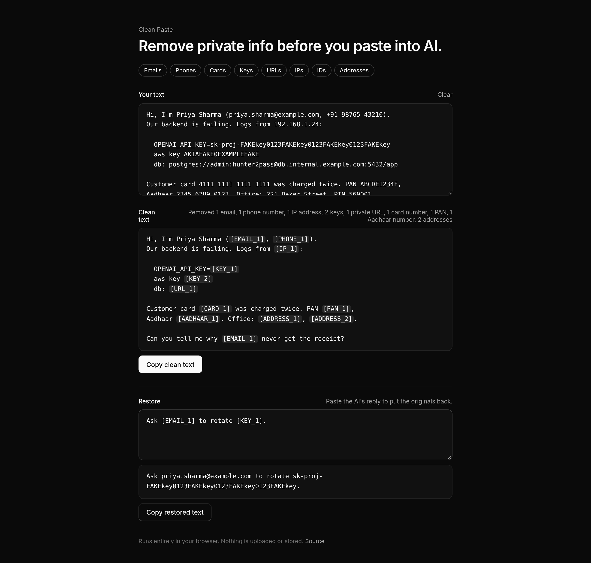

# Clean Paste

**Remove private info before you paste into AI.**

**Live:** https://gfxroy.github.io/clean-paste/



Paste a log, an email thread, a support ticket or some code. Clean Paste swaps out the private parts for neat placeholders like `[EMAIL_1]` and `[KEY_1]`, so you can paste the clean copy into ChatGPT, Claude or Gemini. Then paste the AI's reply back in and the originals are restored.

## Features

- **Two layers, both on your device.** Fast rules mask things the moment you type. About 300 ms after you stop typing, a small AI model running in your browser ([`onnx-community/bert-small-pii-detection-ONNX`](https://huggingface.co/onnx-community/bert-small-pii-detection-ONNX), about 29 MB, cached after the first visit, WebGPU or WASM) catches names, places and anything the rules missed.
- **Free-form wording works.** `card number - 4111 …`, `my card no is …`, `my pin 4821`, `password - hunter2`, `aadhaar 1234 5678 9012`, `call me at 98765 43210`, `cvv 123`, `expiry 08/27`, UPI IDs, IFSC codes and account numbers.

- **Instant cleaning as you type.** Placeholders are numbered consistently, so the same email is always `[EMAIL_1]`.
- **What it catches:**
  - emails
  - phone numbers (Indian +91, US, international)
  - card numbers (Luhn-checked)
  - API keys and tokens (OpenAI, AWS, GitHub, Google, Slack, Stripe, JWTs, private keys, generic high-entropy strings)
  - labeled secrets: `password is …`, `key: …`, `DB_PASSWORD=…`, `"token": "…"`, `?token=…`, `Bearer …` (only the value is hidden, the label stays)
  - IPv4/IPv6 addresses
  - URLs carrying tokens or credentials
  - Aadhaar, PAN and SSN numbers
  - simple street addresses and PIN codes
- **A one-line summary** such as "Removed 2 emails, 1 key".
- **Restore.** Paste the AI's reply and the placeholders turn back into the real values. It works with or without the brackets.
- **Category toggles** so you can keep whatever you want to leave in.

## Privacy

Everything runs in your browser. Nothing is uploaded, logged or stored. The placeholder mapping only lives in memory and is gone when you close the tab.

This is pattern matching, not a guarantee. Read the clean text before you share it.

## Develop

```bash
npm install
npm run dev     # local dev server
npm test        # detector tests (Vitest)
npm run build
```

Built with Vite, React and TypeScript, and deployed to GitHub Pages with GitHub Actions.

## License

MIT © Aaditya Roy
